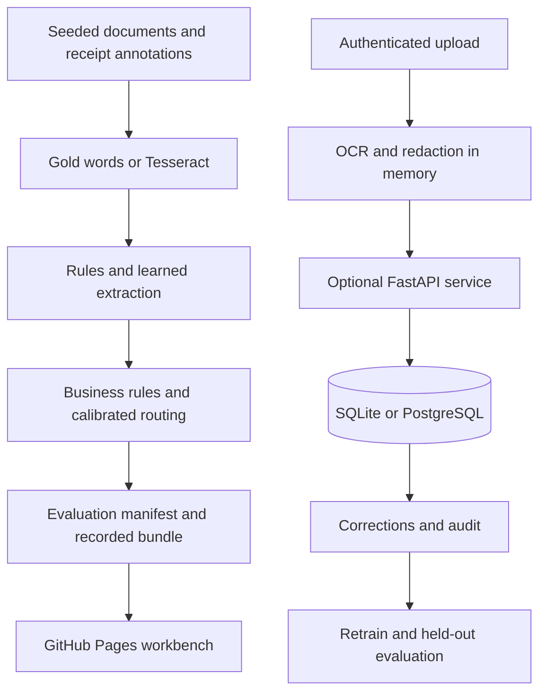

# Architecture

Docket is a recorded document intelligence workbench deployed on GitHub Pages, with an optional FastAPI service for durable review and uploads. The published mode was selected by the owner. Browser practice changes are stored locally and never represented as server audit events.

Generated pages and licensed receipt annotations feed two independent input paths: known words and words read by Tesseract. Both feed the same extraction interfaces. A rules extractor provides inspectable candidates; a learned token classifier provides a second baseline. Business rules, held-out calibration, and a validation-selected confidence threshold decide whether a page needs review.

The gap between extraction on gold words and extraction on OCR words identifies the contribution of OCR errors. A single accuracy figure cannot tell whether the next improvement belongs in recognition or field extraction. Metrics identify their population, backend, split, and sample size. A small receipt subset cannot establish performance on a real company's mailroom.

The static site needs no credentials. API tokens are configured separately and must never appear in source, build output, URLs, or recorded data. Uploads must pass size and page limits and redaction before storage. A database transaction commits corrections and audit records before a success response. A fresh database connection verifies persistence.

## Reproducibility boundary

The committed manifest records a canonical measured run. Reports are deterministic renderings of that manifest. CI rejects edited reports that no longer match the source evidence. Re-running OCR can change measurements across Tesseract and image-library versions; that is a new evidence run and should be committed as such, with its environment identified.

Demonstration documents only. Generated invoices contain fictional vendors and transactions. Public CORD receipts are attributed separately.
